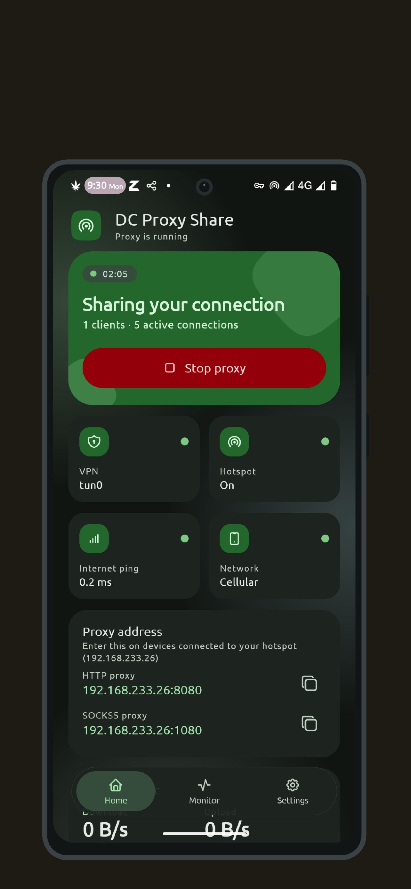
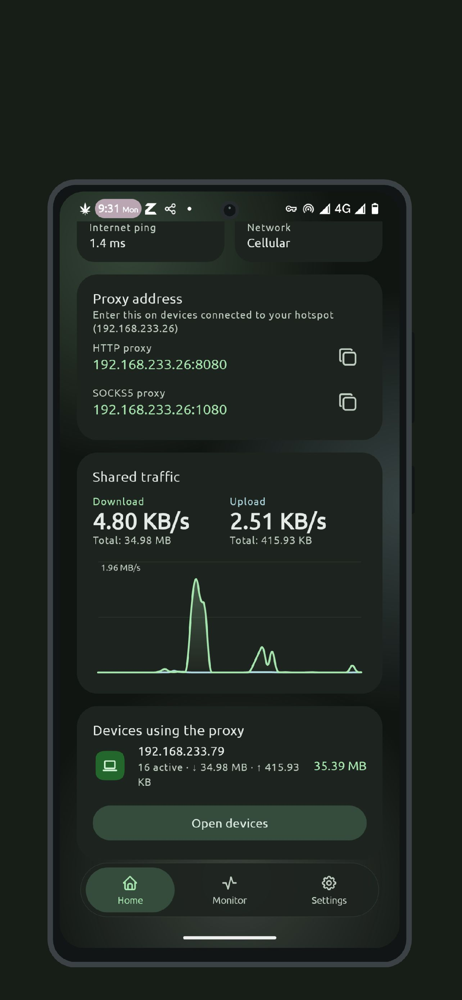
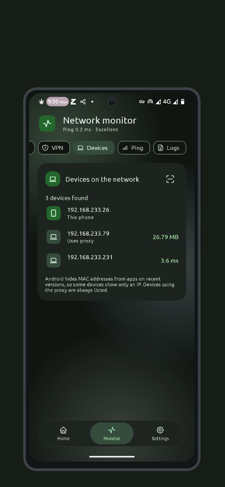
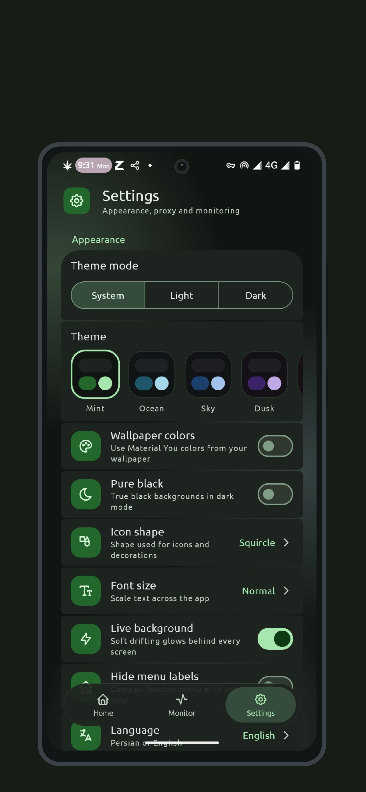

<div align="center">


# DC Proxy Share

**Share your phone's VPN connection over the hotspot with a built-in HTTP and SOCKS5 proxy and a full network monitor.**

[](https://github.com/deepcodecreate/Dc-Proxy-Share/releases)
[](https://github.com/deepcodecreate/Dc-Proxy-Share/actions)
[](LICENSE)


[Download](https://github.com/deepcodecreate/Dc-Proxy-Share/releases/latest) · [Report a bug](https://github.com/deepcodecreate/Dc-Proxy-Share/issues) · [License](LICENSE)

</div>

<br>

<div align="center">
<table>
<tr>
<td></td>
<td></td>
<td></td>
<td></td>
</tr>
</table>
</div>

<br>


[](https://deepcodecreate.github.io/lumenstore/app.html?id=proxy.share.dc)

## Features

| | |
|---|---|
| **Proxy** | HTTP/HTTPS and SOCKS5 with custom ports, running as a foreground service with a stop action |
| **Home** | Live shared traffic and the devices currently using the proxy |
| **Overview** | Internet status, DNS time, public IP, active network, phone and proxy traffic |
| **Wi-Fi** | Signal, link speed, band, channel, security, IP configuration, hotspot |
| **VPN** | Interface, protocol, addresses, routes, exit IP and country |
| **Devices** | Local network scan and proxy clients |
| **Ping** | Live ping, jitter, loss, history chart, multi-target comparison |
| **Logs** | Filterable event log with share and clear |
| **Look** | 8 themes in light and dark, wallpaper colors, pure black, icon shapes, font size, motion levels |
| **Languages** | Persian and English |

## Quick start

1. Turn on your VPN and the phone hotspot.
2. Open the app and tap **Start proxy**.
3. On the other device, join the hotspot and set the proxy to the address shown on the Home screen.

| Protocol | Default setting |
|---|---|
| HTTP / HTTPS | `HOTSPOT_IP:HTTP_PORT` |
| SOCKS5 | `HOTSPOT_IP:SOCKS_PORT` |

## Build

The app has no native code, so one APK runs on arm64-v8a, armeabi-v7a, x86 and x86_64. The build also writes a universal APK and one APK per ABI.

Requirements: JDK 17 and Gradle 8.13 or newer.

```
gradle assembleDebug
gradle assembleRelease
```

APKs are written to `app/build/outputs/apk`.

### Signing

Debug and release APKs are signed with `app/proxyshare.jks`. If the file is missing, Gradle generates it automatically before signing, so builds always produce installable APKs.

### GitHub Actions

The workflow in `.github/workflows/build.yml` builds the debug and release APKs on every push and pull request and uploads them as artifacts. Pushing a tag such as `v1.0` also publishes them as a GitHub release.

## Notes

- Android hides MAC addresses from apps on recent versions, so the device scan can show only IP addresses.
- The Wi-Fi name needs the location permission.
- The web check and public IP lookup use gstatic.com and ipwho.is and can be turned off in Settings.

## License

Released under the [MIT License](LICENSE).

Copyright (c) 2026 [@deepcodecreate](https://github.com/deepcodecreate)
